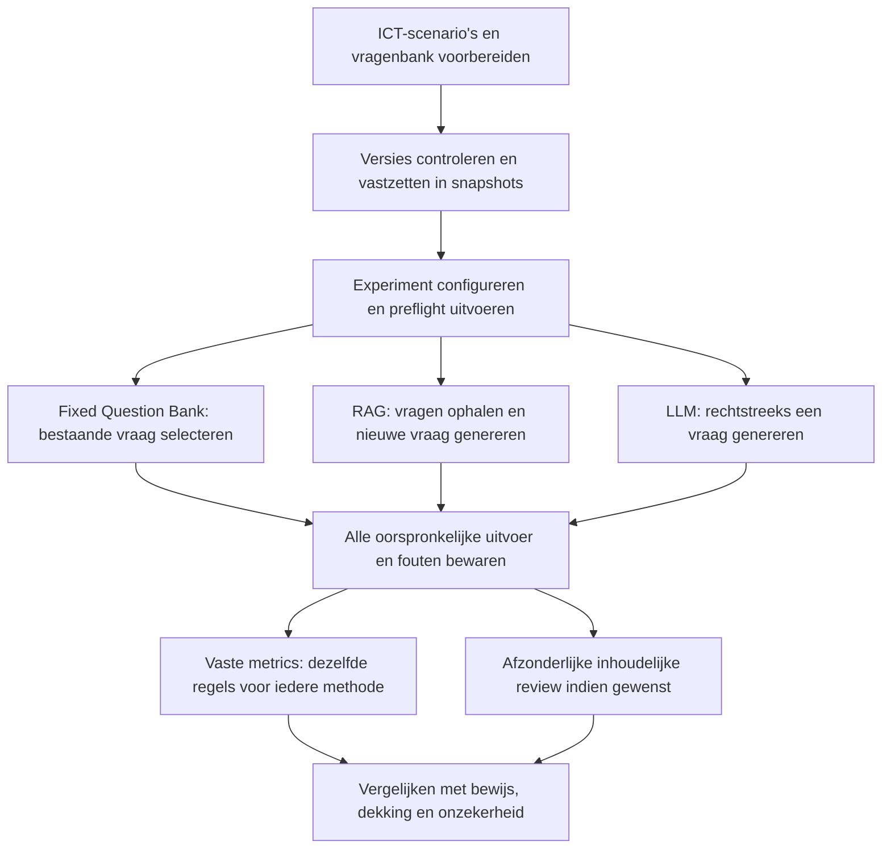
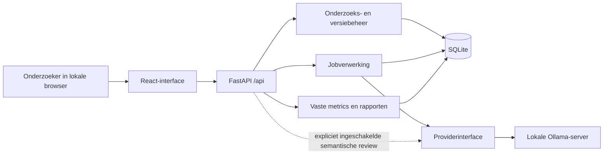

# Zelfregiekompas Research Lab

Bij dit document hoort een [uitvoerbare Jupyter-notebook](Zelfregiekompas_projectopbouw_en_metrics.ipynb) die de projectopbouw stap voor stap uitlegt, belangrijke broncode toont en de ontwikkeling van metrics v2 naar v3 demonstreert.

## Architectuur, functionaliteit, Responsible AI en onderzoek naar reflectievragen

**Documentstatus:** beschrijving van de geïmplementeerde applicatie op 30 oktober 2026. De actuele vaste beoordelingsversie is `fixed-rubric-v3-method-blind`.

**Doelgroep:** onderzoekers, beoordelaars en begeleiders die willen begrijpen wat de applicatie doet, hoe methoden en modellen worden vergeleken en welke conclusies de metingen toelaten.

## 1. Doel en afbakening

De applicatie is een lokale onderzoeksomgeving voor het selecteren en genereren van reflectievragen bij ICT-leerscenario’s. Een scenario beschrijft bijvoorbeeld een student die Python-functies oefent, SQL-query’s schrijft of een netwerkconfiguratie onderzoekt. Het onderzochte resultaat is de **reflectievraag die bij dat scenario wordt gekozen of opgesteld**. De applicatie beoordeelt hiermee niet automatisch de kennis, het functioneren of de geschiktheid van de student.

De centrale onderzoeksvraag is:

> Welke verschillen vertonen de reflectievragen van Fixed Question Bank, RAG en een rechtstreeks aangestuurd LLM, wanneer zij dezelfde scenario’s verwerken en met dezelfde vastgelegde beoordelingsregels worden onderzocht?

De omgeving ondersteunt daarnaast modelonderzoek: binnen RAG en binnen de directe LLM-methode kunnen verschillende geïnstalleerde modellen worden vergeleken. De applicatie traint of finetunet die modellen niet.

Drie activiteiten blijven van elkaar gescheiden:

1. **Onderzoeksmateriaal voorbereiden:** scenario’s en bankvragen maken, controleren, verbeteren en vastzetten.
2. **Uitvoer verzamelen:** per scenario de geselecteerde of gegenereerde reflectievraag bewaren.
3. **Uitvoer beoordelen:** achteraf dezelfde vaste scripts toepassen en eventuele semantische beoordelingen apart vastleggen.

Deze scheiding voorkomt dat een gegenereerd antwoord direct als een goed antwoord wordt behandeld. Een experiment kan technisch afgerond zijn terwijl een deel van de uitvoer ongeldig is of inhoudelijk nog beoordeling vraagt.

## 2. De applicatie in één overzicht

De vaste beoordeling is de standaardroute. Een optionele lokale AI-inschatting van semantische kwaliteit is beschikbaar, maar staat standaard uit en verandert de vaste metrics niet. Automatische AI-beoordeling tijdens de experimentverzameling is uitgeschakeld.

## 3. Technische architectuur

### 3.1 Componenten en verantwoordelijkheden

| Onderdeel | Technologie | Verantwoordelijkheid |
| --- | --- | --- |
| Gebruikersinterface | React en TypeScript | Scenario’s, vragenbanken, snapshots, experimenten en resultaten beheren; bewijs en versies inspecteren. |
| Applicatie-API | FastAPI | Verzoeken valideren, onderzoeksregels toepassen en gegevens beschikbaar stellen via `/api`. |
| Onderzoekslogica | Python | Versiebeheer, selectie, retrieval, experimentplanning en evaluatie uitvoeren. |
| Achtergrondverwerking | Persistente jobregistratie met één worker | Langdurige generatie uitvoeren, voortgang bewaren en onderbreking/herstart ondersteunen. |
| Opslag | SQLite | Onderzoeksrecords lokaal en transactioneel bewaren. De opslag bevat JSON-records met typen en unieke ID’s. |
| Modelprovider | Providerinterface met Ollama-implementatie | Geïnstalleerde lokale modellen controleren en daadwerkelijke generatieverzoeken uitvoeren. |
| Vaste evaluator | Python-scripts | Methodeblind controleerbare eigenschappen, herkende overtredingen en onzekerheid registreren. |

De browser spreekt de onderzoeksbackend aan. De backend spreekt, wanneer generatie nodig is, Ollama aan. De vaste metrics gebruiken geen generatief model. Bij normaal productiegebruik serveert FastAPI ook de gebouwde frontend.

### 3.2 Waarom deze architectuur bij onderzoek past

De interface hoeft tijdens generatie niet open te blijven om ieder resultaat apart op te slaan: experimenten bestaan als jobs met afzonderlijke uitvoerrecords. Na een onderbreking blijven eerder opgeslagen resultaten beschikbaar. Hervatten is expliciet; wijzigingen in relevante implementatie- of modelidentiteit kunnen hervatten blokkeren om het mengen van verschillende onderzoekscondities te voorkomen.

SQLite-transacties beperken gedeeltelijke opslagbewerkingen. Dat is een technische integriteitsmaatregel, geen garantie dat de inhoud van een scenario correct is. De providerinterface houdt modelcommunicatie apart van de onderzoekslogica. Daardoor kunnen providerfouten worden getest zonder in softwaretests echte modelresultaten te simuleren als onderzoeksuitvoer.

De huidige applicatie is ingericht als **lokale onderzoeksomgeving voor één gebruiker**. Zij is geen productieplatform met accounts, rollen en centrale toegangscontrole voor een hele onderwijsinstelling.

### 3.3 Wat als onderzoeksrecord wordt bewaard

| Record | Onderzoeksbetekenis |
| --- | --- |
| Dataset en scenarioversies | De inhoud en herkomst van de onderzochte situaties. |
| Vragenbank en vraagversies | De beschikbare vragen, voorwaarden, prioriteiten en herkomst. |
| Reviews | Welke versie is gecontroleerd, met welke beslissing, reviewer-ID en toelichting. |
| Snapshots | De exacte verzameling versies waarmee een experiment werkt. |
| Experiment/job | Methoden, modellen, instellingen, herhalingen, volgorde en voortgang. |
| Uitvoerrecord | De reflectievraag, scenarioversie, methode, model, status, oorspronkelijke respons en beschikbare uitvoeringsinformatie. |
| Selectie- en retrievaltrace | Welke bankvraag is gekozen of welke voorbeelden zijn opgehaald, met regels, ID’s en scores. |
| Vast evaluatierapport | Rubricversie, implementatiehash, inputhash, regelversies, bewijs en resultaten. |
| Afzonderlijke semantische beoordeling | Menselijke beoordeling of optionele lokale AI-inschatting, met een eigen herkomst. |

Nieuwe vaste evaluatierapporten worden als afzonderlijke, onveranderbare applicatierecords toegevoegd. Een herbeoordeling vervangt de oorspronkelijke uitvoer of het vorige rapport niet. Oude en nieuwe rapporten kunnen naast elkaar worden geopend en geëxporteerd.

Deze onveranderbaarheid geldt voor de applicatieroutes. Een beheerder met rechtstreekse toegang tot het databasebestand kan technisch nog wijzigingen aanbrengen. Hashes maken integriteitscontrole mogelijk, maar zijn geen digitale handtekening of extern beveiligd archief.

## 4. Functionaliteit per werkruimte

| Werkruimte | Wat de onderzoeker kan doen | Bijdrage aan het onderzoek |
| --- | --- | --- |
| **Overview** | Werkruimte overzien en duidelijk gemarkeerde demonstratiegegevens maken. | Een werkende start zonder demonstratiemateriaal voor gevalideerde data aan te zien. |
| **Scenarios** | Datasets aanmaken; JSON, JSONL of CSV importeren; imports vooraf bekijken; zoeken, filteren, genereren, reviseren en beoordelen. | Expliciete en inspecteerbare invoer voor alle methoden. |
| **Question bank** | Meerdere banken beheren; vragen toevoegen, importeren of lokaal genereren; tekst en toepassingsregels controleren; versies beoordelen. | Een onafhankelijke, herleidbare basis voor Fixed en RAG. |
| **Snapshots** | Goedgekeurde actuele versies vastzetten. Experimentele bankversies kunnen expliciet voor ontwikkeling worden gebruikt. | Voorkomen dat de dataset of bank ongemerkt verandert tijdens een vergelijking. |
| **Experiments** | Methoden, generatoren, instellingen, snapshots, split en herhalingen kiezen; preflight en batch starten; jobs volgen, stoppen, hervatten of archiveren. | Gecontroleerde verzameling van daadwerkelijke uitvoer. |
| **Evaluation** | Vaste metrics uitvoeren; per vraag het scenario, regels en bewijs bekijken; op methode, criterium, status en versie selecteren; oude en nieuwe rubrics vergelijken. | Verschillen zichtbaar maken zonder de herkomst in de inhoudelijke scorer te gebruiken. |
| **Metrics** | Operationele resultaten, regeluitkomsten en beschrijvende kenmerken per onderzoeksconditie vergelijken. | Rapportage met expliciete noemers en onzekerheid. |
| **Models** | Lokale verbinding testen; geïnstalleerde modellen en metadata inspecteren; bewust een model installeren en een inferentietest uitvoeren. | De gebruikte modelvariant kunnen vaststellen en operationele problemen herkennen. |
| **Protocol & records** | Prompts, regels, instellingen, herkomst en exportmogelijkheden inspecteren. | Controleerbaarheid en verantwoording van onderzoekskeuzes. |

Modelinstallatie is een afzonderlijke actie. Een model bekijken of selecteren installeert het niet. Een verbindings- of inferentietest bewijst dat de verbinding of een eenvoudige generatie werkt; zij bewijst geen goede reflectievragen.

## 5. Wat een scenario bevat

De toegestane invoer staat in `Inputs` in [het schema](../backend/schema.py).

| Veld | Betekenis | Voorbeeld |
| --- | --- | --- |
| `learning_goal` | Wat de student wil leren. | Python-functies begrijpen. |
| `planned_activity` | De geplande ICT-activiteit. | Een functie schrijven en testen. |
| `progress` | Beschrijving en eventueel geplande/voltooide eenheden. | Twee van vier stappen geregistreerd. |
| `planned_time` | Geplande tijd met eenheid. | 20 minuten. |
| `reported_time` | Gerapporteerde tijd met eenheid. | 35 minuten. |
| `control_results` | Controlevraag, studentantwoord, eventueel referentieantwoord en geregistreerde beoordeling. | Antwoord op een Python-controleopgave is als onjuist vastgelegd. |
| `student_note` | Aanvullende toelichting van de student. | Een gekozen aanpak of ontbrekende registratie. |
| `previous_question` | De eerdere reflectievraag, indien bekend. | Wordt onder meer gebruikt om exacte herhaling te herkennen. |

Ontbrekende informatie is onbekend, niet automatisch nul, succes of falen. Een geregistreerd correct controleantwoord is geen bewijs dat de hele activiteit is afgerond. Een afwijkende tijd bewijst geen frustratie of slechte planning.

Onderzoeksmetadata staat buiten deze invoer: bijvoorbeeld labels, split, categorieën en beoordelaarsfeedback. De generatie gebruikt een expliciete allow-list, zodat zulke gegevens niet ongemerkt modelinvoer worden. Een AI-afgeleide controlebeoordeling wordt niet behandeld als een geobserveerd studentresultaat.

Nieuwe generatie richt zich op ICT, waaronder programmeren, SQL/databases, web/API’s, testen/Git, netwerken/beveiliging en softwareontwerp. Synthetische variaties omvatten onder meer gedeeltelijke voortgang, ontbrekende informatie en bewuste tegenstrijdigheden. Lexicale ICT-controles helpen duidelijke afwijkingen vinden; zij vervangen geen inhoudelijke materiaalcontrole.

## 6. De drie onderzochte methoden

### 6.1 Fixed Question Bank

Fixed kiest een bestaande vraag uit de vastgezette bank. Er wordt tijdens deze selectie geen LLM aangeroepen.

De voorwaarden kunnen aangeven dat informatie aanwezig of ontbrekend moet zijn, dat een tekstfragment moet voorkomen, dat twee getallen een bepaalde verhouding hebben of dat een controleantwoord als correct/onjuist is geregistreerd. Tijdvergelijkingen houden rekening met eenheden.

De uitvoering controleert ook herkenbare technologieverwijzingen en exacte herhaling. Bij meerdere specifieke kandidaten wint eerst de hoogste prioriteit, daarna de genormaliseerde specificiteit en vervolgens de stabiele vraag-ID. Zonder specifieke kandidaat kan een geschikte onvoorwaardelijke fallback worden gekozen. Ontbreekt ook die, dan wordt een fout geregistreerd.

**Onderzoekspunt:** geeft een vooraf gecontroleerde bank voldoende passende keuzes voor verschillende situaties? Grenzen zijn de inhoud en dekking van de bank, de gekozen voorwaarden en de prioriteitsregels. Een geselecteerde vraag is door selectie alleen nog niet inhoudelijk gevalideerd.

### 6.2 RAG

De huidige RAG-implementatie haalt voorbeelden op uit dezelfde soort vragenbank en gebruikt die in een generatieprompt. Retrieval is **lexicaal: TF-IDF met cosinusvergelijking**, niet een embeddingdatabase.

Alleen toepasselijke bankvragen kunnen worden opgehaald. De tekstwaarden uit het scenario vormen de zoekvraag; bankvraagteksten vormen de documenten. De implementatie bewaart de gevonden vraagversies en scores. Standaard worden maximaal drie suggesties opgehaald en geldt een minimumscore van 0,12. Als niets die grens haalt, wordt dat expliciet als ontbrekende relevante match vastgelegd.

Daarna genereert het lokale model een vraag met het scenario en de opgehaalde suggesties. De bankprioriteit bepaalt de RAG-ranking niet. De retrievalscore is ook **geen evaluatiescore voor de uiteindelijke reflectievraag**.

**Onderzoekspunt:** helpt het aanbieden van passende voorbeelden bij het opstellen van een reflectievraag? Mogelijke problemen zijn een zwakke retrievalmatch, onjuist overgenomen aannames of een model dat ondanks goede voorbeelden een kennisvraag produceert.

### 6.3 Rechtstreeks aangestuurd LLM

De methode `constrained` krijgt de toegestane scenario-invoer en de algemene instructies voor één korte reflectievraag, zonder bankvragen of retrieval.

RAG en deze directe methode gebruiken dezelfde algemene generatiebeperkingen. RAG heeft bewust extra context uit retrieval; de prompts zijn daarom niet volledig identiek. Deze extra context is onderdeel van de methode die wordt onderzocht.

**Onderzoekspunt:** kan het gekozen model zelfstandig een passende reflectievraag formuleren? Mogelijke problemen zijn een technische kennisvraag, verzonnen aannames, herhaling of ongeldige uitvoer.

### 6.4 Vergelijking

| Aspect | Fixed | RAG | Direct LLM |
| --- | --- | --- | --- |
| Bestaande vragenbank nodig | Ja | Ja | Nee |
| Nieuwe vraagtekst tijdens experiment | Nee | Ja | Ja |
| Modelaanroep tijdens verzameling | Nee | Ja | Ja |
| Invloed van bank | Tekst, voorwaarden en prioriteiten | Toepasbare voorbeelden en retrieval | Geen |
| Belangrijkste onderzochte keuze | Selectie uit bestaand aanbod | Selectie van context plus generatie | Generatie vanuit scenario |
| Vaste evaluatie achteraf | Dezelfde v3-scorer | Dezelfde v3-scorer | Dezelfde v3-scorer |

## 7. Hoe dit methodeonderzoek en modelonderzoek ondersteunt

### 7.1 Methodeonderzoek

Voor een methodevergelijking worden dezelfde scenarioversies gebruikt. Fixed en RAG gebruiken dezelfde gekozen bankversie. RAG en direct LLM gebruiken hetzelfde model en dezelfde generatie-instellingen. De opzettelijke verschillen blijven de selectie- en generatieaanpak en de extra retrievalcontext.

De app bewaart iedere uitvoer onder een exacte scenarioversie, methode, model en herhaling. Vergelijkingen kunnen worden beperkt tot scenario/herhaling-combinaties die in alle condities voorkomen. Een mislukte uitvoering verdwijnt niet uit het aantal geplande gevallen.

Voorbeeld: 36 scenario’s × drie methoden × één herhaling met één generator levert 108 geplande resultaten op.

### 7.2 Modelonderzoek

Verschillende modellen worden bij voorkeur **binnen dezelfde methode** vergeleken. Zo kan worden onderzocht of model A binnen RAG andere uitkomsten geeft dan model B, en of dat verschil ook bij directe generatie optreedt.

Fixed heeft zelf geen generator. Bij twee generatoren en alle drie de methoden ontstaan per scenario één Fixed-conditie, twee RAG-condities en twee directe LLM-condities: vijf condities, niet zes. Met 36 scenario’s en één herhaling zijn dat 180 resultaten.

De app registreert modelnaam, exact geïnstalleerde digest en beschikbare metadata. Instellingen zoals seed, temperatuur, context- en uitvoerbudget worden vastgelegd. Een gewijzigde of ontbrekende modelidentiteit mag niet ongemerkt door een ander model worden vervangen. Een naam of tag alleen is onvoldoende om een modelvariant te reproduceren.

Herhalingen kunnen variatie onderzoeken. Voor modelgeneratie wordt een opgegeven basis-seed per herhaling verhoogd. Identieke Fixed-selecties herhalen levert geen extra onafhankelijke evidentie op. Ook bij vaste seeds is identieke LLM-uitvoer over andere hardware of softwareversies niet gegarandeerd.

### 7.3 Wat dit niet automatisch aantoont

Een hogere score op een tekstregel maakt een architectuur niet algemeen beter. De uitkomst hangt mede af van bankkwaliteit, retrieval, prompts, modelvariant, instellingen, scenarioverdeling en gekozen indicatoren. Een zorgvuldig vooraf gecontroleerde bank en nieuwe onbeoordeelde LLM-uitvoer hebben verschillende voorbereidende inspanningen; die moeten in de onderzoeksinterpretatie worden benoemd.

De applicatie maakt deze keuzes traceerbaar, maar voert niet automatisch een statistische poweranalyse, representativiteitsonderzoek of meting van studentleerwinst uit.

## 8. Wat betekent een passende reflectievraag?

**Passendheid is in dit onderzoek een inhoudelijk begrip met meerdere onderdelen.** Een vraag hoort aan te sluiten bij de beschikbare leersituatie, reflectie uit te lokken, begrijpelijk te zijn en de student ruimte te geven voor een eigen antwoord.

| Onderdeel | Centrale beoordelingsvraag |
| --- | --- |
| Reflectief karakter | Gaat het om leren, keuzes, aanpak, bewijs of een volgende stap, of uitsluitend om het reproduceren van vakkennis? |
| Aansluiting op context | Past de vraag bij het leerdoel, de activiteit en de relevante beschikbare of ontbrekende informatie? |
| Feitelijke gronding | Zijn de aannames in de vraag ondersteund, en worden onbekende of tegenstrijdige gegevens gerespecteerd? |
| Duidelijkheid | Is duidelijk waarop de student kan reflecteren en wordt niet onnodig veel tegelijk gevraagd? |
| Autonomie en bejegening | Is de formulering open en niet dwingend, veroordelend of diagnostisch? |

Deze inhoudelijke definitie is breder dan wat de scripts zelfstandig vaststellen. De scripts leveren **afgebakende indicatoren en signalen**. Zij spreken geen compleet automatisch eindoordeel uit dat een vraag pedagogisch passend is.

Een belangrijk onderscheid:

> “De vraag voldoet aan de gecontroleerde regels” is een onderbouwde uitspraak over die regels. “Deze vraag verbetert het leren van deze student” vraagt aanvullende inhoudelijke en empirische onderbouwing.

### 8.1 Kennisvraag versus reflectievraag

**Kennisvraag:** “What is the default TCP port for HTTPS?”

Hier wordt een technisch antwoord gevraagd. De vraag kan aansluiten bij een netwerkonderwerp, maar dat maakt haar nog geen reflectievraag.

**Mogelijk reflectief:** “What led you to select that port when configuring the HTTPS service?”

Hier staat de gemaakte keuze centraal. De formulering veronderstelt wel dat de student een poort heeft gekozen. Alleen een geplande configuratieopdracht bewijst die uitgevoerde keuze niet. De vraag kan dus een herkenbare reflectiestructuur hebben en tegelijk een onvoldoende ondersteunde feitelijke aanname bevatten.

**Open planning:** “What would you record about your progress to help you plan your next ICT learning step?”

Deze vraag kan structureel als reflectie op planning worden herkend zonder een afgeronde taak te veronderstellen. Dat bewijst nog niet dat dit voor iedere student de meest behulpzame vraag is.

De generatie en de meeste herkenningspatronen zijn ingericht op Engelse vraagtekst. De Nederlandse uitleg in dit document impliceert geen gevalideerde Nederlandstalige scorer.

## 9. De vaste v3-rubrics

De inhoudelijke regels staan in [fixed_rules_v3.py](../backend/fixed_rules_v3.py). [script_evaluation.py](../backend/script_evaluation.py) organiseert batchbeoordeling, opslag en aggregatie.

### 9.1 Mechanisch formaat — `format`

Afzonderlijke controles registreren onder meer niet-lege uitvoer, het aantal vraagtekens, eindigen op een vraagteken, maximaal 40 woorden, één regel, herkenbare extra antwoordtekst en genormaliseerde exacte herhaling van de vorige vraag.

Een vraagteken tellen is betrouwbaar programmeerbaar. Vaststellen dat een zin semantisch precies één vraag bevat is moeilijker. Daarom wordt expliciet vermeld welke mechanische controle is uitgevoerd. Onherkende taal of structuur wordt niet zomaar een taalfout. De taalcheck blijft onbeslist omdat geen gevalideerde taalherkenner is ingericht.

Een niet-lege maar ongeldig afgesloten respons blijft in de formaatnoemer staan. De enkele geciteerde RAG-respons in de bestaande test wordt daardoor zichtbaar als één fout op 108 uitvoerregels.

### 9.2 Vraagstructuur — `reflection_structure`

De regels herkennen conservatieve patronen voor leren en strategie, beslissingen en aanpak, resultaten en bewijs, en planning of vervolgstappen. Duidelijke kennis-/herinneringspatronen worden apart gesignaleerd. Niet eenduidig herkenbare vragen blijven ambigu.

Losse woorden zijn onvoldoende. Het woord “plan” in “SQL query plan” is geen bewijs voor reflectie op een leerplanning. Een herkenbaar patroon blijft bovendien een structurele aanwijzing, geen volledige beoordeling van echte reflectie of leerwaarde.

### 9.3 Contextuele gronding — `contextual_grounding`

De evaluator onderzoekt expliciete verwijzingen naar toegestane scenariovelden en herkenbare technologieën. Een Python-verwijzing zonder ondersteuning in een scenario over een netwerkservice kan worden gesignaleerd. Een expliciete toekomstige suggestie om een technologie te proberen vraagt een andere interpretatie dan doen alsof die technologie al gebruikt is.

Woordoverlap wordt afzonderlijk beschreven. Overlap bewijst geen volledige relevantie; geen overlap bewijst geen irrelevantie. Een parafrase kan inhoudelijk goed aansluiten terwijl de herkenningsregels dat niet kunnen vaststellen.

Een `pass` in deze dimensie betreft de gecontroleerde expliciete verwijzingen. Het is geen volledige goedkeuring van contextuele passendheid.

### 9.4 Feitelijke gronding — `factual_grounding`

De regels controleren herkenbare beweringen over tijd, aantallen, voortgang, taakafronding, geregistreerde controleantwoorden, technologieën en sommige prestaties of handelingen.

**Voorbeeld:** het scenario bevat 20 geplande en 35 gerapporteerde minuten. “Why did you spend only 15 minutes on this activity?” is in strijd met de registratie. De vergelijking normaliseert naar 900 tegenover 2100 seconden.

“Could you spend 15 minutes on practice next time?” is een mogelijke toekomstige keuze en wordt niet als een onjuiste registratie van het verleden behandeld. Een hypothetisch geformuleerde hoofdvraag wist daarentegen een ingebedde onjuiste aanname niet uit: “What might explain why you recorded 15 minutes?” bevat nog steeds een claim over geregistreerde tijd.

Bij tegenstrijdige bronnen wordt geen waarheid verzonnen. Als de gestructureerde voortgang twee van vier stappen noemt en de notitie zegt dat alle vier klaar zijn, wordt het conflict bewaard en blijft de betrokken claim onbeslist.

Geen herkende feitelijke claim is geen bewijs van correcte feiten. Veel open reflectievragen blijven voor deze dimensie terecht onbeslist.

### 9.5 Autonomie en formulering — `agency_wording`

De evaluator kan duidelijk herkenbare dwingende of veroordelende formuleringen en bepaalde emotionele, prestatiegerichte of diagnostische aannames signaleren. Een niet-onderbouwde vraag waarom een student heeft gefaald is niet gerechtvaardigd doordat de voortgang onbekend is.

De regels zijn bewust terughoudend. Geen gevonden problematische frase bewijst geen respectvolle toon of behoud van autonomie in de volledige betekenis van die begrippen. Die interpretatie blijft inhoudelijke review vragen.

### 9.6 Diversiteit en herhaling

Naast de rubrics worden lengte, exacte en genormaliseerde unieke vragen, duplicaten, herhalingsaandeel en hergebruik over scenario’s beschreven. Deze kenmerken worden niet in een kwaliteitsscore gemiddeld.

Een bruikbare bankvraag mag in meerdere passende scenario’s voorkomen. Een LLM-vraag is niet beter alleen omdat zij anders geformuleerd is. Herhaling van de **vorige vraag binnen de beschikbare scenario-invoer** is bovendien iets anders dan beschrijvend hergebruik over een dataset.

## 10. Statussen, bewijs en interpretatie

| Status | Betekenis | Betekent niet |
| --- | --- | --- |
| `pass` | De specifieke gecontroleerde eigenschap wordt ondersteund. | De hele vraag is pedagogisch goedgekeurd. |
| `flag` | Een regel heeft een afgebakende overtreding of onvoldoende ondersteunde claim gedetecteerd. | Alle onderdelen van de vraag zijn onbruikbaar. |
| `inconclusive` | De beschikbare gegevens of regels geven geen uitsluitsel. | Automatisch fout of automatisch goed. |
| `skipped` | Inhoudelijke beoordeling was niet mogelijk, bijvoorbeeld bij uitvoeringsfouten. | Een positief beoordeelde vraag. |

`requires_review` is een aparte workflowstatus. Het is geen extra kwaliteitscijfer. Een vraag kan mechanisch aan regels voldoen en toch inhoudelijke review nodig hebben.

Ieder individueel resultaat bevat een criterium-ID, rubricversie, regel-ID en regelversie, status, bewijs, toelichting, gebruikte scenariovelden en de grens tussen het deterministische signaal en benodigde semantische interpretatie. Het rapport bewaart daarnaast output- en scenarioreferenties, tijdstip, inputhash en implementatiehash.

### 10.1 Hoe hiermee een passendheidsoordeel wordt onderbouwd

De praktische leesvolgorde is:

1. Bekijk het leerdoel, de activiteit, bekende gegevens en ontbrekende of conflicterende informatie.
2. Controleer technische/formatmatige geldigheid.
3. Bekijk of een reflectiestructuur of juist een kennisvraag is herkend.
4. Onderzoek expliciete contextverwijzingen en feitelijke signalen met het bijbehorende bewijs.
5. Bekijk eventuele signalen over bejegening en autonomie.
6. Laat openstaande inhoudelijke vragen als onbeslist staan of leg een afzonderlijke inhoudelijke review vast.

Een bruikbare rapportagezin is:

> De vraag voldoet aan de mechanische vormregels en vertoont een herkenbare reflectiestructuur. De expliciete contextverwijzingen zijn ondersteund. Niet alle semantische aannames kunnen door de vaste regels worden vastgesteld; pedagogische passendheid is daarom niet volledig aangetoond.

### 10.2 Eerlijke noemers

Rapporteer geplande gevallen, succesvolle uitvoer en fouten afzonderlijk. Niet-lege ongeldige uitvoer telt mee bij formaatcontrole. Inhoudelijke controles kunnen uitvoeringsfouten overslaan, terwijl die fouten in het geplande totaal blijven staan.

Beslisdekking is het aandeel beoordeelde gevallen waarvoor een regel `pass` of `flag` geeft. Toon die dekking naast onbesliste uitkomsten. Een hoog aandeel passes onder alleen beslisbare gevallen kan misleidend zijn als bijna alles onbeslist blijft.

Er wordt geen totaalkwaliteitsscore berekend door onvergelijkbare criteria te middelen. Onderzoeksmethoden worden ook niet automatisch gerangschikt op het aantal deterministische passes.

## 11. Methodeblindheid en reproduceerbaarheid

De inhoudelijke vaste scorer krijgt alleen vraagtekst en toegestane scenario-invoer. Methode, model, bankprioriteit, herkomst, retrievalranking, onderzoekslabels en AI-afgeleide beoordeling zijn geen beoordelingsinputs. De indeling per methode en model gebeurt pas daarna.

Daarmee geldt als testbare eis:

> Dezelfde reflectievraag bij hetzelfde scenario krijgt dezelfde vaste beoordeling, ongeacht het etiket Fixed, RAG of LLM.

Methodeblindheid vermindert een bron van evaluatieverschil, maar bewijst niet dat iedere regel een valide maat voor onderwijskwaliteit is. Ook een consequent toegepaste ongeschikte regel kan consequent verkeerde conclusies geven.

Bij wijzigingen ontstaat een nieuwe evaluatieversie of een afzonderlijk rapport met een eigen implementatie-identiteit. Historische snapshots, uitvoer en rapporten blijven beschikbaar. De v2-bron is gearchiveerd; zowel v2 als v3 zijn op de opgeslagen testuitvoer exact gereproduceerd.

Dit onderscheidt **reproduceerbaarheid van scripts** van **herhaalbaarheid van modelgeneratie**: identieke opgeslagen invoer kan dezelfde scriptmeting geven, terwijl een nieuwe LLM-generatie op andere infrastructuur toch kan verschillen.

## 12. Responsible AI: concrete onderbouwing

Responsible AI is hier een ontwerp- en onderzoeksaanpak. De app ondersteunt aantoonbare maatregelen voor controle, inzichtelijkheid en risicobeperking. Alleen de aanwezigheid van deze functies bewijst geen volledige naleving, certificering of afgeronde ethische toetsing.

Als referentiekader dienen de zeven aandachtspunten uit de Europese richtlijnen voor betrouwbare AI. De onderstaande koppeling is een projectanalyse, geen door de Europese Commissie uitgevoerde beoordeling. [Bron: Ethics Guidelines for Trustworthy AI](https://digital-strategy.ec.europa.eu/en/library/ethics-guidelines-trustworthy-ai).

| Aandachtspunt | Geïmplementeerde ondersteuning | Wat nog onderbouwing of organisatie vraagt |
| --- | --- | --- |
| Menselijke autonomie en toezicht | Materiaalcontrole, versiegebonden goedkeuring, open vraaginstructies, zichtbare onzekerheid en optionele afzonderlijke review. | Een reviewer-ID bewijst geen identiteit of onafhankelijke deskundigheid. Studenten en docenten hebben de vragen nog niet daarmee gevalideerd. |
| Technische robuustheid en veiligheid | Schemas, foutregistratie, preflight, modelidentiteitscontrole, jobherstel en regressietests. | Tests dekken bepaalde gevallen en bewijzen geen volledige foutloosheid of weerstand tegen alle aanvallen. |
| Privacy en databeheer | Lokale onderzoeksopslag, lokale providercontroles, synthetische cases, beperkte modelinvoer en uitsluiting van niet-toegestane metadata. | Werkelijke studentgegevens vragen passende afspraken over toegang, opslag, bewaartermijnen en gebruik. Lokale opslag is geen automatische anonimisering. |
| Transparantie | Inspecteerbare prompts, selectie-/retrievaltraces, exacte versies, hashes en bewijs per beoordelingsregel. | Uitlegbaarheid van de omliggende regels betekent niet dat de interne werking van een LLM volledig verklaard is. |
| Diversiteit, non-discriminatie en fairness | Dezelfde beoordelingsfunctie voor alle methoden; onderwerpen en scenario-variaties kunnen expliciet worden verdeeld. | Geen aangetoonde fairness voor studentgroepen, talen of ondersteuningsbehoeften. Methodeblindheid is geen bewijs van afwezige bias. |
| Maatschappelijke en ecologische gevolgen | Beperkte onderzoeksdoelstelling en expliciete beperking van conclusies. | Geen gemeten leerwinst, brede maatschappelijke impact of energie-/milieuscore. Lokale inferentie is niet vanzelf duurzamer. |
| Verantwoording | Herleidbare keuzes, oorspronkelijke fouten, afzonderlijke rapportversies, exports en integriteitscontroles. | De onderzoeker blijft verantwoordelijk voor interpretatie en gebruik; audits vragen ook organisatorische afspraken. |

Voor een systematische zelfbeoordeling kan de officiële [ALTAI-beoordelingslijst](https://digital-strategy.ec.europa.eu/en/library/assessment-list-trustworthy-artificial-intelligence-altai-self-assessment) worden gebruikt. Dit document is geen ingevulde ALTAI-toets.

### 12.1 Lokale verwerking met duidelijke grenzen

De provider accepteert gecontroleerde lokale adressen en expliciet toegestane hosts, controleert geïnstalleerde modelinformatie en weigert herkenbare cloud-/remotevarianten. De browser gebruikt de eigen API; redirects en omgevingsproxies worden voor providerverzoeken niet automatisch gevolgd.

Modelinstallatie en expliciet verversen van openbare catalogusmetadata kunnen internet gebruiken. Dat is gescheiden van het versturen van onderzoeksscenario’s voor lokale inferentie. De Ollama-server en eventuele toegestane netwerkhosts moeten wel correct beheerd worden; de app kan niet bewijzen hoe een extern ingerichte proxy of machine werkelijk is geconfigureerd.

De huidige SQLite-opslag heeft vanuit deze code geen ingebouwde versleuteling of meergebruikersautorisatie. Bestandsrechten, back-ups, apparaatbeveiliging en eventueel schijfversleuteling zijn dus aanvullende beheertaken. Een lokale architectuur ondersteunt dataminimalisatie, maar bewijst op zichzelf geen juridische naleving van bijvoorbeeld de AVG of de AI-verordening.

### 12.2 Verantwoord gebruik van AI tijdens het onderzoek

AI mag materiaal of reflectievragen opstellen, maar gegenereerde inhoud wordt niet daardoor als waarheid opgeslagen. De materiaalcontrole en de trace van mislukte pogingen zijn juist belangrijk: in de uitgevoerde test bleken lokaal gegenereerde voorwaarden en controleantwoorden correctie nodig te hebben.

De standaard vaste evaluatie is onafhankelijk van een AI-beoordelaar. De optionele lokale semantische laag vraagt expliciete inschakeling en bewaart zes onderbouwde schattingen met ankers van 1–4 of `null`, plus modeldigest, promptversie en instellingen. Deze schattingen zijn geen grondwaarheid en wijzigen de vaste regels niet. De bestaande handmatige beoordeling blijft eveneens afzonderlijk.

### 12.3 Continue risicobeheersing

NIST AI RMF biedt een vrijwillig raamwerk voor het beheersen van AI-risico’s. De vier kernfuncties kunnen in dit project worden vertaald naar verantwoordelijkheden vastleggen, de onderwijscontext afbakenen, resultaten en onzekerheid meten, en gevonden problemen met behoud van historie aanpakken. Dit is een toepasbare onderzoekswerkwijze, geen bewering dat een formele NIST-beoordeling is afgerond. [Bronnen: NIST AI RMF](https://www.nist.gov/itl/ai-risk-management-framework), [AI RMF Core](https://airc.nist.gov/airmf-resources/airmf/5-sec-core/).

### 12.4 Verdedigbare formulering voor een onderzoeksverslag

> Binnen mijn onderzoek operationaliseer ik Responsible AI met lokale verwerking, beperkte modelinvoer, controleerbaar materiaal, herleidbare experimentcondities en methodeblinde vaste evaluatie. De applicatie bewaart fouten en onzekerheid en voorkomt dat een nieuwe rubric oude resultaten vervangt. Daarmee ondersteun ik transparantie, toezicht en verantwoording. Deze technische maatregelen vormen geen volledige ethische of juridische certificering; representativiteit, fairness en pedagogische effectiviteit vragen aanvullende validatie.

## 13. Wat de uitgevoerde vergelijking laat zien

De bestaande vergelijking gebruikte 32 nieuwe bankvragen en 36 synthetische ontwikkelscenario’s: zes ICT-onderwerpen en zes situaties. Alle drie de methoden verwerkten dezelfde scenario’s. RAG en direct LLM gebruikten `llama3.2:1b`, één herhaling en gelijke generatie-instellingen.

De materiaalvoorbereiding omvatte assistentgestuurde constructie en controle na problemen met lokale generatie. Dit was geen onafhankelijke menselijke validatie. De scenariocases vormden een ontwikkelset, geen onafhankelijk representatief eindonderzoek.

| Methode | Succesvol / gepland | Formaat pass / flag | Reflectiestructuur pass / flag / onbeslist | Feitelijke signalen pass / flag / onbeslist |
| --- | --- | --- | --- | --- |
| Fixed Question Bank | 36 / 36 | 36 / 0 | 36 / 0 / 0 | 1 / 0 / 35 |
| RAG | 35 / 36 | 35 / 1 | 8 / 22 / 5 | 2 / 4 / 29 |
| Direct LLM | 36 / 36 | 36 / 0 | 0 / 29 / 7 | 1 / 3 / 32 |

Dit zijn **v3-regeluitkomsten**, geen totaalcijfers voor onderwijskwaliteit. De vaste bank levert in deze set vaker een herkenbaar reflectief vraagpatroon. De kennisvraagpatronen bij de generatoren zijn relevant voor de onderzoeksdoelstelling, maar pedagogische bruikbaarheid en algemene superioriteit zijn daarmee niet bewezen.

V3 controleert alle 108 niet-lege outputs op formaat: 107 voldoen. De ongeldige RAG-respons telt mee als formaat-/uitvoeringsfout. Voor inhoudelijke beoordeling blijven 107 resultaten over.

De 15-minutenclaim tegenover 35 geregistreerde minuten wordt nu gesignaleerd. Veel andere vragen blijven voor feitelijke gronding onbeslist omdat zij geen door de regels controleerbare feitelijke claim bevatten. Dat is een grens aan de meting, niet automatisch een gebrek van die vragen.

De v3-herbeoordeling is retrospectief ontwikkeld na het vinden van v2-problemen. Een verschil tussen v2 en v3 is dus een verschil in meetinstrument, niet een verbetering van de eerder gegenereerde vragen. Nieuwe bevestigende experimenten vragen een vooraf vastgezette rubric en onafhankelijke validatiegegevens.

De vastgelegde verificatie meldt 203 geslaagde backendtests, drie geslaagde browsertests en een geslaagde frontendbuild. Oude en nieuwe rapporten zijn exact gereproduceerd; oorspronkelijke records en bestanden zijn op integriteit gecontroleerd. Dit onderbouwt de geteste softwarewerking, niet de volledige validiteit van passendheid als onderwijsconstruct. Zie [vergelijking en controlebewijs](fixed-metrics-v3/COMPARISON.md) en [validatierecord](fixed-metrics-v3/validation.json).

## 14. Aanbevolen werkwijze voor vervolgonderzoek

1. Formuleer vooraf of de hoofdvraag een methode-, model- of combinatievergelijking is.
2. Definieer ICT-onderwerpen, situaties, aantallen en relevante uitzonderingen voordat resultaten worden bekeken.
3. Controleer scenario’s en bankvragen; registreer wie controleert en of dat onafhankelijk menselijk of geassisteerd gebeurt.
4. Zet dataset en bank vast in snapshots. Bewaar ontwikkeling, validatie en testfamilies gescheiden.
5. Leg modellen, digests, instellingen, seeds, herhalingen en de huidige rubric vast. Test bereikbaarheid en preflight.
6. Verzamel alle geplande resultaten. Bewaar ongeldige uitvoer en voer geen selectieve herstelgeneraties uit om scores gunstiger te maken.
7. Pas dezelfde vaste metrics op alle methoden toe en vergelijk dezelfde scenarioversies en herhalingen.
8. Rapporteer formaat, gedetecteerde overtredingen, onzekerheid, dekking en beschrijvende kenmerken afzonderlijk.
9. Als een claim over echte inhoudelijke passendheid nodig is, valideer dan tegen onafhankelijke deskundige beoordelingen. Houd eventuele lokale AI-schattingen herkenbaar gescheiden.
10. Bevries bevestigende meetregels vóór een nieuwe test. Nieuwe correcties krijgen een eigen versie en herbeoordeling; oude resultaten blijven beschikbaar.

Een vast script verwijdert variatie door veranderende beoordelingsprompts of beoordelaars, maar een script kan nog steeds een ongeschikte operationalisatie bevatten. De combinatie van vaste uitvoering, transparant bewijs en onafhankelijke validatie maakt de onderzoeksconclusie sterker.

## 15. Wegwijzer naar implementatie en bewijs

| Onderdeel | Bron in de repository |
| --- | --- |
| Starten en algemeen gebruik | [README](../README.md) en `scripts/start.ps1` |
| API en lokale toegangsbeperkingen | [backend/main.py](../backend/main.py) |
| Scenario-, vraag- en beoordelingsschema’s | [backend/schema.py](../backend/schema.py) |
| Materiaal, versies, reviews en snapshots | [backend/research.py](../backend/research.py) |
| Database en append-only evaluatierecords | [backend/store.py](../backend/store.py) |
| Experimentplanning en uitvoering | [backend/jobs.py](../backend/jobs.py) |
| Selectie, retrieval en generatiecontext | [backend/methods.py](../backend/methods.py) |
| Provider en modelcompatibiliteit | [backend/provider.py](../backend/provider.py), [backend/model_policy.py](../backend/model_policy.py) |
| Individuele v3-regels | [backend/fixed_rules_v3.py](../backend/fixed_rules_v3.py) |
| Aggregatie, versie-identiteit en opslag | [backend/script_evaluation.py](../backend/script_evaluation.py) |
| Optionele semantische laag | [backend/semantic_evaluation.py](../backend/semantic_evaluation.py) |
| Evaluatie-interface | [ScriptEvaluation.tsx](../frontend/src/pages/ScriptEvaluation.tsx), [Evaluation.tsx](../frontend/src/pages/Evaluation.tsx) |
| Rubricdefinities en beperkingen | [v3-protocol](fixed-metrics-v3/PROTOCOL.md) |
| Audit en oude/nieuwe vergelijking | [audit](fixed-metrics-v3/AUDIT.md), [vergelijking](fixed-metrics-v3/COMPARISON.md) |
| Oorspronkelijke onderzoeksmaterialen | [testprotocol](final-test-20261030/protocol.json), [oorspronkelijk rapport](final-test-20261030/RESULTATEN.md) |

De externe Responsible AI-bronnen in hoofdstuk 12 zijn geraadpleegd op 30 oktober 2026. Zij dienen als referentiekader; uitspraken over de implementatie zijn gebaseerd op de hierboven genoemde code en onderzoeksrecords.
